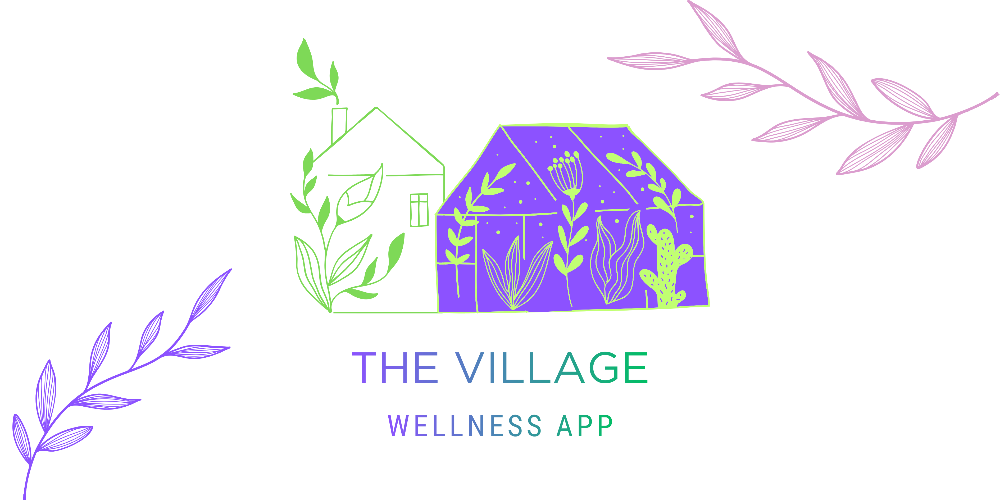
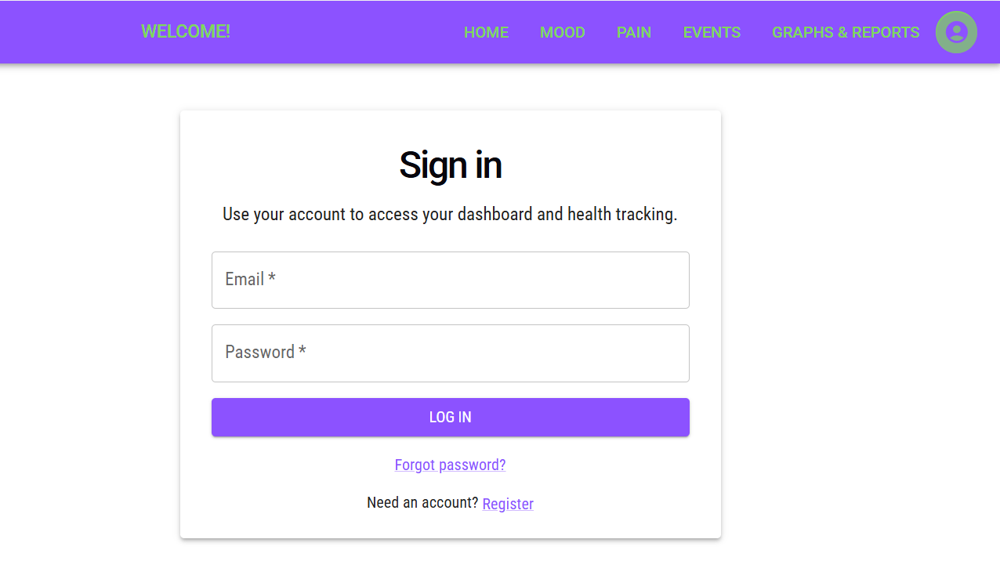
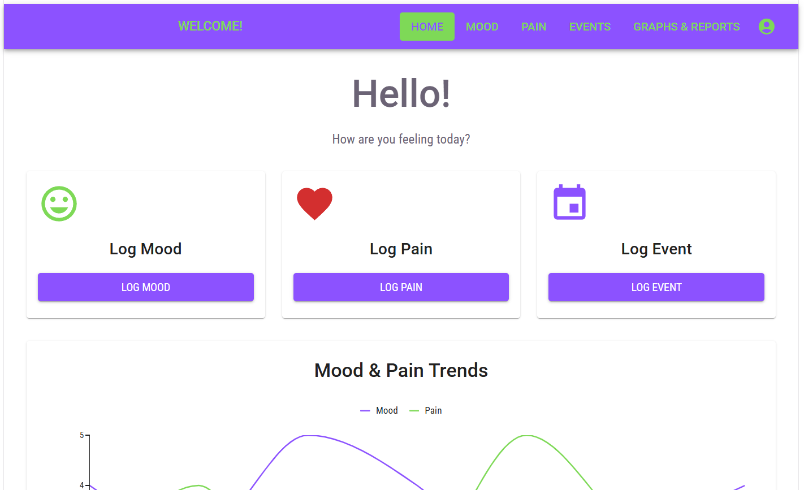
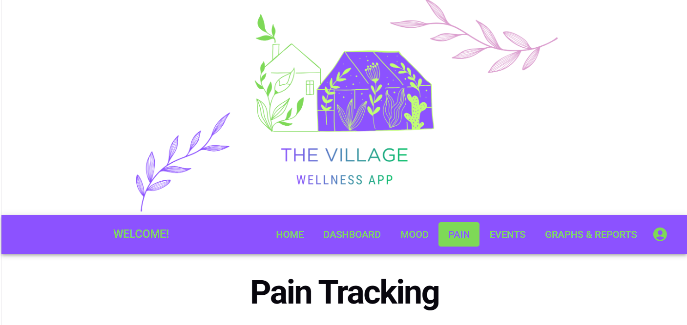
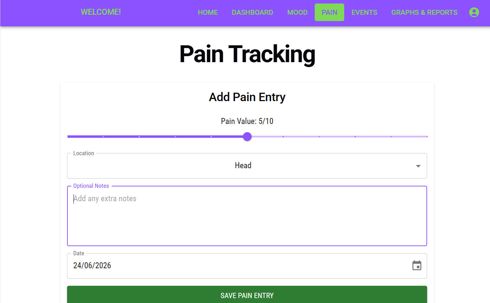
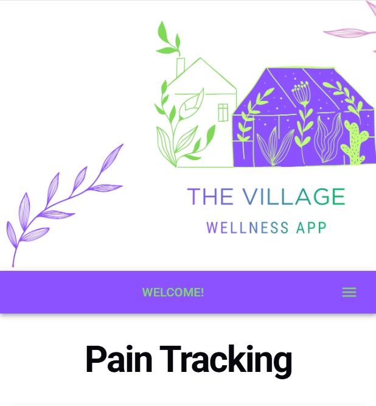
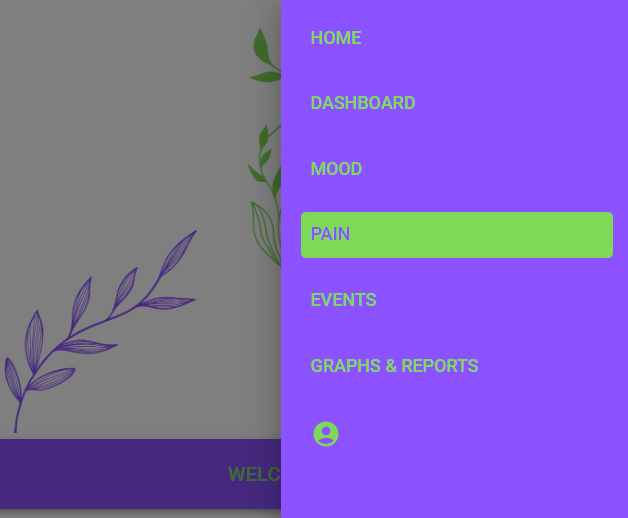

 <picture>
  <source media="(prefers-color-scheme: dark)" srcset="./public/banner-dark.png">
  <source media="(prefers-color-scheme: light)" srcset="./public/banner-light.png">
  
</picture>

---

## Navigation

- [Overview of Project](#overview-of-project)
- [The Village Wellness App](#the-village-wellness-app)
- [Overview of Frontend Application](#overview-of-frontend-application)
- [Project Features](#project-features)
- [Tech Stack](#tech-stack)
- [Chosen Technologies](#chosen-technologies)
- [Industry Relevance](#industry-relevance)
- [Comparison to Alternative Technologies](#comparison-to-alternative-technologies)
- [Licensing Information](#licensing-information)
- [JavaScript Style Guide](#javascript-style-guide)
- [ESLint Configuration](#eslint-configuration)
- [Brand Guide](#brand-guide)
- [Packages](#packages)
- [System Requirements](#system-requirements)
- [Project Structure](#project-structure)
- [Testing](#testing)
- [Code Coverage](#code-coverage)
- [Installation](#installation)
- [Running the Application](#running-the-application)
- [Scripts](#scripts)
- [Continuous Integration and Deployment](#continuous-integration-and-deployment)
- [Deployment](#deployment)
- [App Preview](#app-preview)
- [Responsive Design](#responsive-design)
- [License](#license)
- [References](#references)
- [Authors](#authors)

---

## Overview of Project

This frontend application was created as part of an academic Web Development assessment using MongoDB, Express.js, React and Node.js (MERN Stack). The frontend application forms the second assessable task, with the [backend application available here](https://github.com/The-Village-Wellness-App/village-backend/tree/main).

Alternatively, visit the [project organisation](https://github.com/The-Village-Wellness-App) for more information.

## The Village Wellness App

The Village Wellness App is a web-based health and wellbeing tracking application designed to help users monitor changes in their mood and physical pain over time.

The application allows users to record structured entries using rating scales, select predefined labels describing their emotional or physical state, and optionally add contextual notes.

These entries can then be visualised through time-based graphs, enabling users to identify patterns or trends in their wellbeing.

The application also allows users to add event markers to their timeline, such as starting a new medication, beginning therapy, or experiencing a significant life event. These markers provide additional context that may help users understand potential factors influencing their mood or pain levels.

By combining structured tracking with visualisation tools, The Village Wellness App aims to support self-reflection and provide users with useful insights that may assist discussions with healthcare professionals.

## Overview of Frontend Application

The frontend is built using React, a JavaScript library for creating interactive user interfaces.

The application provides users with a responsive platform to access wellness-related tracking features, manage their accounts, and record their current mood and pain levels.

The frontend communicates with a separate Express.js REST API, which handles application requests, authentication and data management. The backend uses MongoDB Atlas for persistent data storage.

The frontend and backend are maintained in separate repositories and deployed independently.

## Project Features

- Create and manage user accounts.
- Log in securely.
- Access personalised wellness tracking.
- Record mood and pain levels.
- Add contextual notes to tracking entries.
- Record significant events.
- View mood and pain data through graphs.
- View and update profile information.
- Navigate through different application sections.
- Switch between application themes.

## Tech Stack

### Chosen Technologies

The application uses the MERN stack, with Vite and additional frontend libraries supporting development and the user interface.

| Technology | Purpose |
| --- | --- |
| MongoDB Atlas | Stores application data |
| Express.js | Handles API routing and middleware |
| React | Builds interactive user interfaces |
| Node.js | Provides the JavaScript runtime environment |
| Vite | Provides frontend development tooling and production builds |
| Material UI | Provides reusable interface components and styling |
| React Router | Provides client-side application routing |
| Day.js | Provides date and time utilities |

### Industry Relevance

The MERN stack is widely used in modern full-stack web development because it enables JavaScript-based development across the frontend and backend.

The technologies used in this application are established tools in contemporary web development.

See the State of JavaScript survey:

- [React Usage](https://share.devographics.com/share/prerendered?localeId=en-US&surveyId=state_of_js&editionId=js2025&blockId=front_end_frameworks_ratios&params=&sectionId=libraries&subSectionId=front_end_frameworks)
- [Express Usage](https://share.devographics.com/share/prerendered?localeId=en-US&surveyId=state_of_js&editionId=js2025&blockId=back_end_frameworks_ratios&params=&sectionId=libraries&subSectionId=back_end_frameworks)
- [JavaScript Testing Tools](https://share.devographics.com/share/prerendered?localeId=en-US&surveyId=state_of_js&editionId=js2025&blockId=testing_ratios&params=&sectionId=libraries&subSectionId=testing)

See the Stack Overflow Developer Survey:

- [MongoDB – Databases](https://survey.stackoverflow.co/2025/technology#most-popular-technologies-database-database)
- [Node.js, React and Express – Web Frameworks](https://survey.stackoverflow.co/2025/technology#most-popular-technologies-webframe-webframe)
- [JavaScript – Programming Languages](https://survey.stackoverflow.co/2025/technology#most-popular-technologies-language-language)

### Comparison to Alternative Technologies

| Chosen Technology | Alternative | Reason Chosen |
| --- | --- | --- |
| MongoDB | PostgreSQL | Flexible document-based data model |
| Express.js | Django | Lightweight, customisable and JavaScript-based |
| React | Angular | Component-based architecture and flexibility |
| Node.js | ASP.NET | Consistent JavaScript development across the stack |
| Vite | Next.js | Lightweight development tooling and flexible configuration |
| Material UI | Chakra UI | Extensive component library and customisation |
| React Router | Next.js App Router | Client-side routing independent of a full-stack framework |
| Day.js | Luxon | Lightweight date and time utility library |

### Licensing Information

| Technology | License |
| --- | --- |
| MongoDB | Server Side Public License (SSPL) |
| Express.js | MIT License |
| React | MIT License |
| Node.js | MIT License |
| Vite | MIT License |
| Material UI | MIT License |
| React Router | MIT License |
| Day.js | MIT License |

**Note:** Although MongoDB uses the SSPL licence, the application itself is licensed under MIT. The project uses MongoDB as an external database service and does not redistribute or modify MongoDB software. The project's MIT licence does not change the licensing obligations applicable to third-party software.

## JavaScript Style Guide

This project uses ESLint to identify potential errors and maintain consistent code quality.

The frontend uses ESLint's flat configuration with recommended JavaScript rules and React-specific linting rules.

To check code quality, run:

```bash
npm run lint
```

For more information, see:

- [ESLint Documentation](https://eslint.org/)
- [Project JavaScript Style Guide](https://github.com/The-Village-Wellness-App/village-documentation/blob/main/javascript-style-guide.md)

## ESLint Configuration

The ESLint configuration is maintained in `eslint.config.js`.

It uses:

- `@eslint/js` recommended rules.
- `eslint-plugin-react-hooks` to identify React Hooks issues.
- `eslint-plugin-react-refresh` to support React Fast Refresh.
- `globals` to configure browser environment globals.

Generated directories such as `dist` and `coverage` are excluded from linting.

## Brand Guide

This project follows a brand guide for CSS styling and visual consistency.

For further information, see the [Brand Guide](https://github.com/The-Village-Wellness-App/village-documentation/blob/main/collateral/brand-guide-the-village.png) or the [Documentation Repository](https://github.com/The-Village-Wellness-App/village-documentation/tree/main).

## Packages

The application uses the following production dependencies.

### Dependencies

```json
{
  "@emotion/react": "^11.14.0",
  "@emotion/styled": "^11.14.1",
  "@fontsource/roboto": "^5.2.10",
  "@fontsource/roboto-condensed": "^5.2.8",
  "@mui/icons-material": "^9.1.1",
  "@mui/material": "^9.1.1",
  "@mui/x-charts": "^9.7.0",
  "@mui/x-date-pickers": "^9.6.0",
  "dayjs": "^1.11.21",
  "react": "^19.2.5",
  "react-dom": "^19.2.5",
  "react-router-dom": "^7.17.0"
}
```

### Development Dependencies

```json
{
  "@eslint/js": "^10.0.1",
  "@testing-library/jest-dom": "^6.9.1",
  "@testing-library/react": "^16.3.2",
  "@testing-library/user-event": "^14.6.1",
  "@types/react": "^19.2.14",
  "@types/react-dom": "^19.2.3",
  "@vitejs/plugin-react": "^6.0.1",
  "@vitest/coverage-v8": "^4.1.12",
  "eslint": "^10.2.1",
  "eslint-plugin-react-hooks": "^7.1.1",
  "eslint-plugin-react-refresh": "^0.5.2",
  "globals": "^17.5.0",
  "jsdom": "^29.1.1",
  "react-transition-group": "^4.4.2",
  "vite": "^8.0.10",
  "vitest": "^4.1.12"
}
```

## System Requirements

- Node.js 22 or later.
- npm.
- A modern web browser (Chrome, Firefox or Edge).
- Internet connection for application API access.

## Project Structure

```text
village-frontend/
├── .github/
│   ├── actions/
│   │   └── frontend-validation/
│   │       └── action.yml
│   └── workflows/
│       └── frontend-ci.yml
├── public/
│   ├── _redirects
│   └── icons.svg
├── src/
│   ├── __tests__/
│   │   ├── api.test.js
│   │   ├── App.test.jsx
│   │   ├── event-page.test.jsx
│   │   ├── Footer.test.jsx
│   │   ├── home-page.test.jsx
│   │   ├── login-page.test.jsx
│   │   ├── LoginForm.test.jsx
│   │   ├── mood-page.test.jsx
│   │   ├── Navbar.test.jsx
│   │   ├── pain-page.test.jsx
│   │   └── ThemeContext.test.jsx
│   ├── assets/
│   ├── components/
│   │   ├── AuthNavbar.jsx
│   │   ├── Footer.jsx
│   │   ├── ForgotPasswordForm.jsx
│   │   ├── Header.jsx
│   │   ├── Header.module.css
│   │   ├── LoginForm.jsx
│   │   ├── Navbar.jsx
│   │   └── RegisterForm.jsx
│   ├── contexts/
│   │   └── ThemeContext.jsx
│   ├── layouts/
│   │   ├── auth-layout.jsx
│   │   └── main-layout.jsx
│   ├── pages/
│   │   ├── event-page.jsx
│   │   ├── graph-report-page.jsx
│   │   ├── home-page.jsx
│   │   ├── login-page.jsx
│   │   ├── mood-page.jsx
│   │   └── pain-page.jsx
│   ├── services/
│   │   └── api.js
│   ├── test/
│   │   └── setup.js
│   ├── App.css
│   ├── App.jsx
│   ├── fonts.css
│   ├── index.css
│   ├── main.jsx
│   └── theme.js
├── .env.example
├── eslint.config.js
├── index.html
├── LICENSE
├── package-lock.json
├── package.json
├── README.md
└── vitest.config.js
```

## Testing

The frontend uses **Vitest** as its test runner and **React Testing Library** to test component rendering and user interactions.

Tests run in a simulated browser environment using JSDOM.

The current test suite contains **11 test files and 48 test cases**.

### Test Coverage Areas

| Test file | Coverage |
| --- | --- |
| `api.test.js` | API request configuration, authentication headers, error handling, and authentication, event, mood and pain API helpers |
| `App.test.jsx` | Application routing and home/login page rendering |
| `event-page.test.jsx` | Event page rendering, empty state, required-field validation and category options |
| `home-page.test.jsx` | Home page rendering |
| `login-page.test.jsx` | Login, registration and password recovery form navigation and validation |
| `LoginForm.test.jsx` | Login form rendering, input interaction and navigation callbacks |
| `mood-page.test.jsx` | Mood page rendering, loading and empty states, slider defaults and save button |
| `pain-page.test.jsx` | Pain page rendering, empty state, slider defaults and location options |
| `Navbar.test.jsx` | Navigation links and welcome text |
| `Footer.test.jsx` | Author links and dynamic copyright year |
| `ThemeContext.test.jsx` | Default theme and theme switching |

### Testing Approach

Tests use mocked API responses and browser storage to isolate frontend behaviour from the backend.

This allows components, API helpers and user interactions to be tested without requiring a running backend or database.

The current suite focuses on unit and component-level testing. It does not perform full end-to-end browser testing or verify complete requests against the live backend and MongoDB database.

## Code Coverage

Code coverage is measured using Vitest's V8 coverage provider.

The latest successful local coverage run reported the following results:

| Coverage Metric | Result |
| --- | ---: |
| Statements | 42.50% |
| Branches | 32.82% |
| Functions | 35.00% |
| Lines | 44.61% |

### Coverage Reports

Vitest generates coverage reports in three formats:

- **Text:** Coverage summary displayed in the terminal.
- **HTML:** Interactive report generated at `coverage/index.html`.
- **LCOV:** Machine-readable coverage report generated at `coverage/lcov.info`.

The HTML report provides file-level coverage details and helps identify application areas requiring additional tests.

Coverage is currently strongest in the API service, application layouts, theme functionality and selected page components. Some areas, including graph reporting and authentication-related components, have limited or no coverage.

Coverage figures represent the current test suite and may change as additional tests are introduced.

### Running Tests and Coverage

Run the complete test suite:

```bash
npm test
```

Generate a coverage report:

```bash
npm run test:coverage
```

Run ESLint:

```bash
npm run lint
```

Create a production build:

```bash
npm run build
```

Coverage reports are generated locally in the `coverage/` directory.

## Installation

Clone the repository:

```bash
git clone https://github.com/The-Village-Wellness-App/village-frontend.git
```

Navigate into the project directory:

```bash
cd village-frontend
```

Install dependencies:

```bash
npm install
```

Create a local `.env` file using `.env.example` as a reference.

Configure the frontend API URL to point to the appropriate backend environment.

Start the development server:

```bash
npm run dev
```

## Running the Application

The application uses Vite for local development and production builds.

### Development Server

Start the local development server:

```bash
npm run dev
```

The application will be available at:

[http://localhost:5173](http://localhost:5173)

### Production Build

Generate an optimised production build:

```bash
npm run build
```

The generated production files are placed in the `dist/` directory.

## Scripts

The following npm scripts are available:

| Script | Description |
| --- | --- |
| `dev` | Starts the Vite development server with hot module replacement |
| `build` | Creates the production build |
| `lint` | Runs ESLint to check code quality |
| `test` | Runs the Vitest test suite |
| `test:coverage` | Runs Vitest and generates code coverage reports |

## Continuous Integration and Deployment

The frontend uses **GitHub Actions** to automate code validation, testing and production deployment.

The CI/CD implementation uses a reusable composite action to centralise frontend validation tasks.

### Workflow Structure

The main workflow is defined in:

```text
.github/workflows/frontend-ci.yml
```

The reusable frontend validation action is located at:

```text
.github/actions/frontend-validation/action.yml
```

### Continuous Integration

The frontend CI workflow runs on:

- Pull requests targeting `main`.
- Pushes to `main`.
- Manual workflow dispatch.

The validation pipeline performs the following steps:

1. Checks out the repository.
2. Sets up the Node.js environment.
3. Installs dependencies using `npm ci`.
4. Runs ESLint to check code quality.
5. Executes Vitest tests with V8 code coverage.
6. Generates JUnit test results and coverage reports.
7. Builds the production application using Vite.
8. Uploads CI artefacts for review.

### CI Artefacts

The workflow uploads generated artefacts using GitHub Actions.

The artefacts include:

| Artefact | Description |
| --- | --- |
| `logs/eslint.log` | ESLint execution output |
| `logs/vitest.log` | Vitest test and coverage output |
| `logs/build.log` | Production build output |
| `test-results/junit.xml` | Machine-readable JUnit test results |
| `coverage/` | HTML and LCOV coverage reports |
| `dist/` | Generated production build files |

CI artefacts are retained for **30 days**.

### Continuous Deployment

Production deployment is handled through GitHub Actions and Netlify.

When changes are pushed to `main`, following successful validation, the workflow deploys the production build from the `dist/` directory to Netlify.

Feature branch pushes do not trigger production deployment.

Sensitive deployment credentials are stored as GitHub Actions secrets. The frontend API URL is configured through GitHub repository variables.

This approach ensures that code is validated before being deployed to the production environment.

## Deployment

The frontend application is deployed using [Netlify](https://www.netlify.com/).

### Production Configuration

| Setting | Value |
| --- | --- |
| Build command | `npm run build` |
| Publish directory | `dist` |
| Deployment platform | Netlify |
| CI/CD platform | GitHub Actions |

Production deployment is automated through the GitHub Actions workflow.

The live application is available here:

[The Village Wellness App – Live](https://the-village-wellness-app.netlify.app/)

## App Preview

Users can register for or sign into their account.



The home page provides a brief overview of the application.



The Village Wellness App welcomes users to each page. Both the full navigation bar and the burger navigation feature a green highlight to indicate the current page.

User account features can be accessed through the person icon.



The main tracking pages — Mood, Pain and Events — allow users to log meaningful events, feelings and experiences, with a journalling section to provide additional context.

For example, a user can record a pain rating of 5 out of 10 and specify the location of the pain.



## Responsive Design

The Village Wellness App features a full navigation bar on larger devices and a condensed burger menu on smaller devices.






## License

This project is licensed under the MIT License. See the [LICENSE](./LICENSE) file for details.

This project uses third-party technologies, including MongoDB, which is licensed under the Server Side Public License (SSPL).

Third-party technologies remain subject to their respective licences.

## References

- MongoDB. (2026). *MERN Stack Explained*. Retrieved May 24, 2026, from [https://www.mongodb.com/resources/languages/mern-stack](https://www.mongodb.com/resources/languages/mern-stack)
- State of JavaScript. (2025). *State of JavaScript 2025: Libraries*. Retrieved May 24, 2026, from [https://2025.stateofjs.com/en-US/libraries/](https://2025.stateofjs.com/en-US/libraries/)
- Stack Overflow. (2025). *2025 Developer Survey*. Retrieved May 24, 2026, from [https://survey.stackoverflow.co/2025/](https://survey.stackoverflow.co/2025/)
- Vitest. *Vitest Documentation*. [https://vitest.dev/](https://vitest.dev/)
- React Testing Library. *React Testing Library Documentation*. [https://testing-library.com/docs/react-testing-library/intro/](https://testing-library.com/docs/react-testing-library/intro/)
- ESLint. *ESLint Documentation*. [](https://eslint.org/)
- GitHub. *GitHub Actions Documentation*. [https://docs.github.com/en/actions](https://docs.github.com/en/actions)
- Netlify. *Netlify Documentation*. [https://docs.netlify.com/](https://docs.netlify.com/)

## Authors

Created by [WhiteHotThrash](https://github.com/tim-maastricht) and [✨BeeGeeEss✨](https://github.com/BeeGeeEss)
